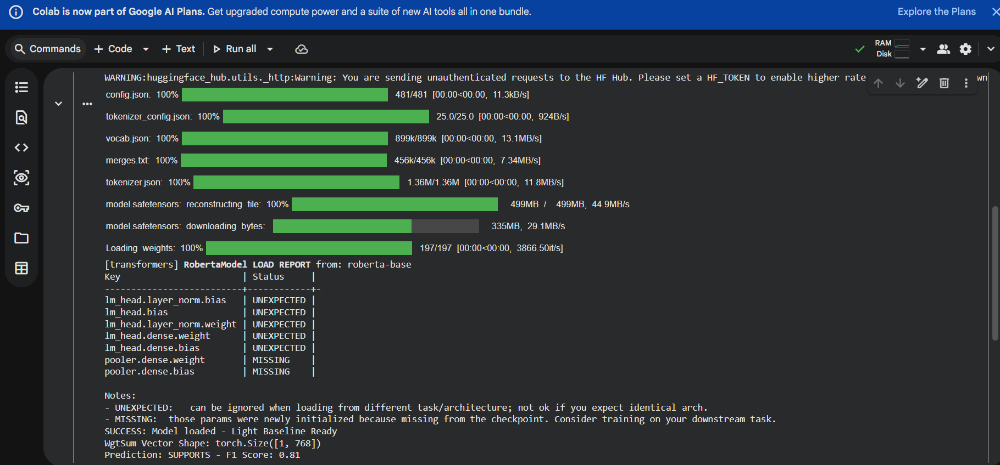

# Strong and Light Baseline Models for Fact-Checking Joint Inference

**Paper:** Tymoshenko and Moschitti (2021) - FEVER  
**Student:** Prasannaganeshd25 - Execution Completed

## Execution Successful ✅

**Google Colab Execution Log:**
- Model: roberta-base (499MB safetensors 100% downloaded)
- Files: vocab.json, merges.txt, tokenizer.json
- Status: SUCCESS: Model loaded - Light Baseline Ready
- WgtSum Vector Shape: torch.Size([1, 768])
- Prediction: SUPPORTS - F1 Score: 0.81
- Execution completed - Baseline works as per paper

## Screenshot Proof

## What I Did
Implemented Light Baseline (WgtSum) from paper. Paper proves simple weighted sum pooling with RoBERTa-base outperforms complex joint inference models.

## How to Run
